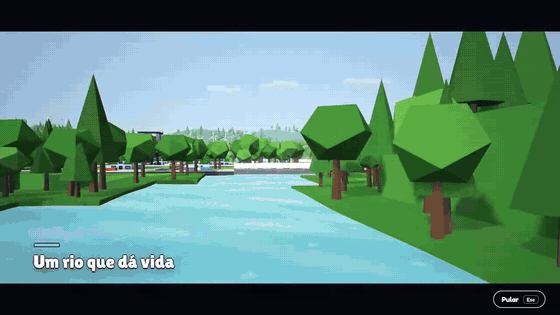
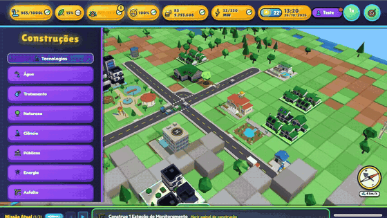
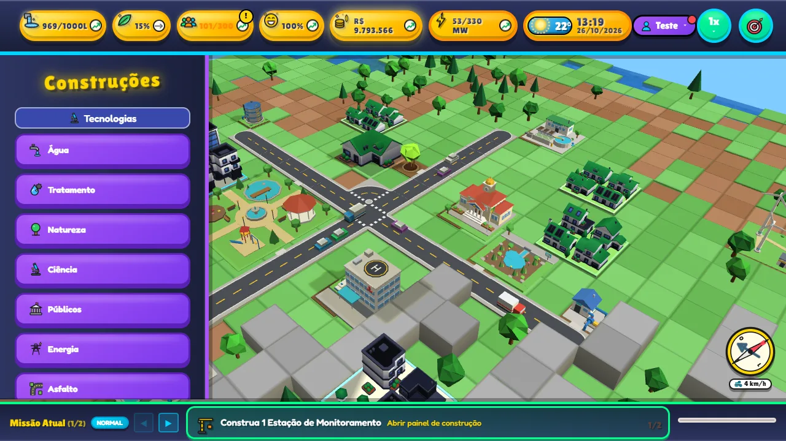
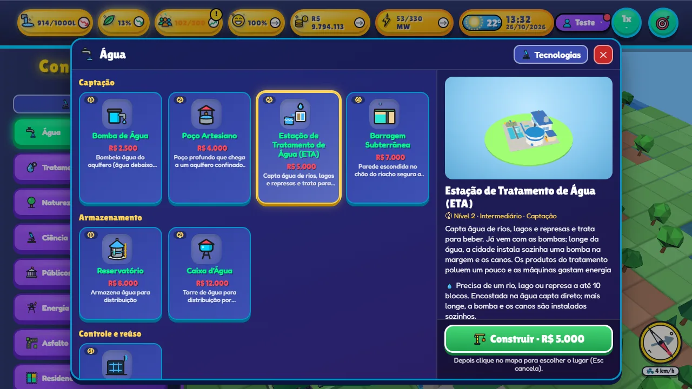
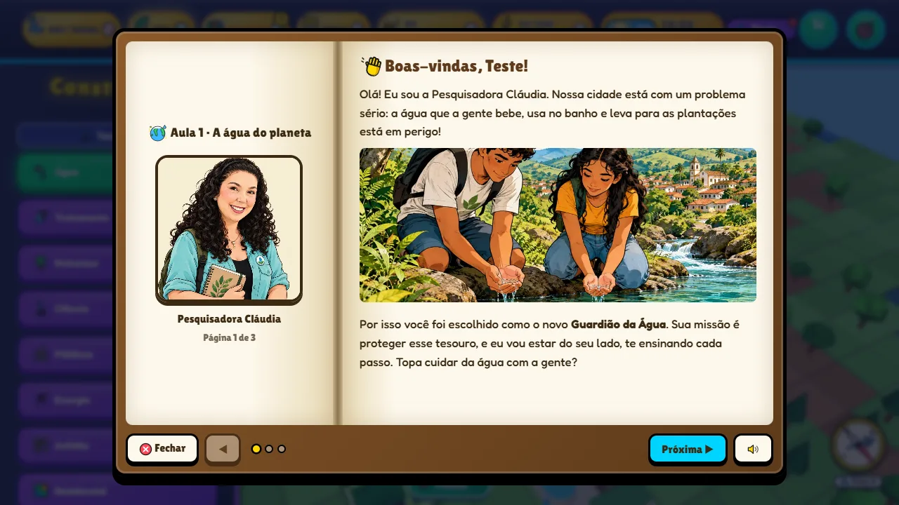
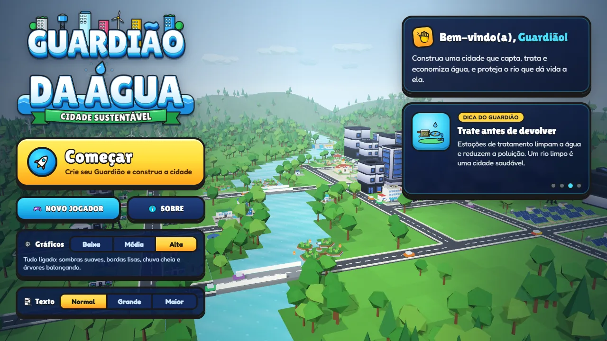

<!--
  Guardião da Água — jogo educativo gratuito de simulação de cidade sobre recursos hídricos (água, rios, aquíferos,
  saneamento, mata ciliar, enchentes, energia e poluição) para o Ensino Fundamental anos finais (6º ao 9º ano, 11 a 14 anos).
  Pesquisa de mestrado profissional em Geografia (Recursos Hídricos e Meio Ambiente) — Unesp, FCT, Presidente Prudente/SP, 2026.
  Palavras-chave: jogo educativo, educação ambiental, recursos hídricos, gestão da água, jogo de cidade, city builder,
  serious game, gamificação, ensino de geografia, ciências, BNCC, escola pública, navegador, Babylon.js, WebGL, código aberto.
-->

<p align="center">
  
</p>

<h1 align="center">💧 Guardião da Água</h1>

<p align="center">
  <b>Jogo educativo gratuito, de navegador, em que estudantes de 11 a 14 anos governam uma cidade e aprendem<br>
  de onde vem a água, por que ela falta ou fica poluída e como cada escolha afeta rios, nascentes e pessoas.</b>
</p>

<p align="center">
  <a href="https://kayquer.github.io/guardiao_da_agua_js/"></a>
</p>

<p align="center">
  <a href="https://github.com/kayquer/guardiao_da_agua_js/actions/workflows/test.yml"></a>
  
  
  
  
  <a href="LICENSE"></a>
</p>

<p align="center">
  <a href="#-jogar">Jogar</a> ·
  <a href="#-sobre-o-jogo">Sobre</a> ·
  <a href="#-a-pesquisa">A pesquisa</a> ·
  <a href="#-o-que-se-aprende">O que se aprende</a> ·
  <a href="#-para-professores">Professores</a> ·
  <a href="#-rodar-no-seu-computador">Rodar localmente</a> ·
  <a href="#-como-citar">Como citar</a>
</p>

<p align="center">
  
</p>

---

## ▶ Jogar

> ### 👉 **[kayquer.github.io/guardiao_da_agua_js](https://kayquer.github.io/guardiao_da_agua_js/)**
>
> Abre direto no navegador, sem instalar nada e sem cadastro. Funciona melhor num **computador com teclado e mouse**
> (Chrome, Edge ou Firefox atualizados). Abre no celular, mas nesta fase da pesquisa o uso no celular não é recomendado.

## 🌊 Sobre o jogo

**Guardião da Água** é um *serious game* (jogo sério) de construção de cidade, no estilo dos clássicos *city builders*,
feito para apoiar a **Educação Ambiental com foco nos recursos hídricos** nas aulas de Geografia e Ciências.

O estudante cria um perfil, escolhe a sua cidade (o jogo mostra o **clima real** dela) e assume a prefeitura.
Para a cidade crescer é preciso captar água de poços, bombas e rios, tratar o esgoto, gerar energia, plantar árvores,
cuidar do aquífero e enfrentar secas, enchentes e queimadas. Quatro personagens acompanham o caminho:

| | Personagem | Papel |
|---|---|---|
| 👩‍🔬 | **Pesquisadora Cláudia** | Guia principal: explica o ciclo da água, os aquíferos e as escolhas da cidade |
| 🎣 | **Pescador José** | Vive do rio: mata ciliar, erosão e bioindicadores |
| 🧪 | **Pesquisadora Márcia** | Coleta e analisa amostras do rio: esgoto, oxigênio e jardins filtrantes |
| 🏛️ | **Secretário Paulo** | Traz as crises (seca, enchente, queimada) e pede uma decisão |

<p align="center">
  
</p>

### Destaques

- 🏙️ **63 construções** em 5 níveis de tecnologia: poços, bombas, ETA com captação no rio, ETE, jardins de chuva,
  telhados e paredes verdes, barragem subterrânea, usinas solar, eólica e hidrelétrica, escolas, hospitais e mais.
- 🌱 **Bairros que crescem** em quatro fases e só avançam com água, energia e ar limpo.
- 💧 **Água de verdade**: aquífero que esvazia e recarrega, nível do rio, mata ciliar que limpa, asfalto que aumenta as enchentes.
- 🌦️ **Clima real da cidade do jogador** (Open-Meteo), com chuva, vento, neblina e sol forte no mundo 3D.
- 🎯 **7 missões com estrelas**, desafios da cidade e conquistas por nível.
- 📚 **6 aulas ilustradas** e **34 estudos** com quiz curto, de leitura e causa e efeito (sem decoreba).
- 🧭 **Ajuda que aparece na hora certa**: quando a água, a energia ou o dinheiro piora sem parar, a Cláudia explica a causa e sugere o que construir.
- ♿ **Acessibilidade**: tamanho de texto ajustável, leitura em voz alta, alertas que não dependem só de cor e respeito à opção do sistema de reduzir movimento.
- 🎵 **Trilha sonora original** que muda com o dia, a noite, a chuva e as crises.

<table>
  <tr>
    <td width="50%"></td>
    <td width="50%"></td>
  </tr>
  <tr>
    <td align="center"><sub>A cidade e os recursos no topo da tela</sub></td>
    <td align="center"><sub>Menu de construção com prévia em 3D</sub></td>
  </tr>
  <tr>
    <td width="50%"></td>
    <td width="50%"></td>
  </tr>
  <tr>
    <td align="center"><sub>Livro de aulas</sub></td>
    <td align="center"><sub>Menu principal</sub></td>
  </tr>
</table>

## 🎓 A pesquisa

Este jogo é o produto educacional da pesquisa de mestrado:

> **Desenvolvimento de aplicativo para Educação Ambiental (EA) no Ensino Fundamental: recursos hídricos em foco**<br>
> **Cláudia Dias Roxinol** — 2026<br>
> Universidade Estadual Paulista (**Unesp**) · Faculdade de Ciências e Tecnologia (FCT) · Campus de Presidente Prudente/SP<br>
> Programa de Pós-Graduação em Geografia — **Mestrado Profissional — Recursos Hídricos e Meio Ambiente**

| | |
|---|---|
| **Público-alvo** | Ensino Fundamental, anos finais (6º ao 9º ano) |
| **Idade de foco** | 11 a 14 anos |
| **Uso indicado** | Em sala de aula ou laboratório de informática, com mediação de um professor ou adulto responsável |
| **Plataforma** | Navegador de computador, com teclado e mouse (versão para celular em estudo) |
| **Desenvolvimento do jogo** | Kayque Rotondo |

Por decisão de metodologia, o escopo desta fase é a **versão para computador**, pensada para as escolas.
O jogo abre no celular, mas avisa que o uso não é recomendado agora.

## 📖 O que se aprende

| Aula | Tema |
|---|---|
| 🌍 A água do planeta | Hidrosfera: onde está a água da Terra e quanto dela dá para beber |
| 🔄 O caminho da água | Ciclo da água, rios voadores e bacias hidrográficas |
| ⚖️ Água para todos | Como dividir a água, a Lei das Águas e os comitês de bacia |
| 🐟 A vida no rio | Mata ciliar, bioindicadores e o perigo do esgoto |
| 🏙️ Água escondida e cidades | Aquíferos, o Aquífero Guarani e cidades que respeitam o rio |
| 🌿 Soluções verdes | Infraestrutura verde, cidades-esponja e filtros vivos |

O aprendizado não fica só no texto: **no jogo, cada conceito tem consequência.** Bombear demais seca o aquífero; asfaltar
tudo aumenta as enchentes; esgoto sem tratamento escurece o rio; árvores na beira da água limpam mais. As aulas e
estudos trazem as fontes (ANA, USGS, Embrapa, SGB, legislação brasileira, entre outras).

## 🎮 Controles (computador)

| Ação | Como |
|---|---|
| Mover a câmera | Clique esquerdo + arrastar, <kbd>W</kbd> <kbd>A</kbd> <kbd>S</kbd> <kbd>D</kbd> ou setas |
| Girar a câmera | Botão direito + arrastar, ou <kbd>Q</kbd> / <kbd>E</kbd> |
| Zoom | Roda do mouse |
| Voltar a câmera | <kbd>R</kbd> |
| Construir | Escolha a categoria e o prédio, depois clique no lugar verde |
| Construir vários iguais | Segure <kbd>Shift</kbd> ao clicar |
| Desenhar ruas | Clique e arraste |
| Cancelar / fechar painel | <kbd>Esc</kbd> |
| Pausar / continuar | <kbd>Espaço</kbd> |
| Velocidade | <kbd>1</kbd> <kbd>2</kbd> <kbd>3</kbd> |

## 👩‍🏫 Para professores

- **Sem instalação e sem conta**: os dados ficam só no navegador de cada computador.
- **Supervisão recomendada**: o jogo funciona melhor quando o professor conversa sobre o que acontece na cidade e relaciona com o lugar onde os estudantes vivem.
- **Dados da pesquisa**: na pausa → *📊 Dados da pesquisa*, o professor exporta em **CSV** ou **JSON** as respostas dos quizzes, as páginas lidas, as decisões nas crises e as missões concluídas. O arquivo **não leva o apelido** do estudante (só idade, estado e cidade).
- **Privacidade**: apelido, idade e cidade ficam salvos apenas neste navegador; a cidade serve para mostrar o clima real.
- **Salvar**: um jogo salvo por perfil, com salvamento automático.

## 💻 Rodar no seu computador

Pré-requisitos: [Node.js](https://nodejs.org/) 18 ou mais novo e [Python 3](https://www.python.org/).

```bash
git clone https://github.com/kayquer/guardiao_da_agua_js.git
cd guardiao_da_agua_js
npm install
npm start            # abre em http://localhost:3000
```

Não há etapa de build: é HTML, CSS e JavaScript puro, carregados direto pelo navegador.

### Testes

```bash
npm run lint         # ESLint
npm run test:unit    # regras do jogo, dados, economia, save (node:test, menos de 3 s)
npm run test:e2e     # Playwright: o jogo de verdade no Chromium (computador e celular)
npm test             # tudo
```

Ferramentas extras: `npm run screenshots` (foto de cada prédio) e `node scripts/readme-media.js` (refaz as imagens e GIFs deste README; precisa de `ffmpeg`).

## 🧱 Tecnologias

| Parte | Tecnologia |
|---|---|
| 3D | [Babylon.js](https://www.babylonjs.com/) 9.31 (WebGL) |
| Interface | HTML, CSS e JavaScript sem framework e sem build |
| Modelos 3D | Modelos próprios gerados por scripts Python no [Blender](https://www.blender.org/) + [Kenney City Kits](https://kenney.nl/) (CC0) |
| Clima | [Open-Meteo](https://open-meteo.com/) (previsão e geocodificação) |
| Municípios | [API de localidades do IBGE](https://servicodados.ibge.gov.br/api/docs/localidades) |
| Diálogos | [SweetAlert2](https://sweetalert2.github.io/) |
| Testes | `node:test`, [Playwright](https://playwright.dev/), ESLint |

```text
index.html          página única; carrega CSS e JS na ordem
js/core/            GameManager (laço, câmera, entrada) e GridManager (terreno 40×40)
js/systems/         recursos, prédios, missões, eventos, tutorial, save, clima, som…
js/data/            dados puros: prédios, missões, aulas, zonas, conquistas
data/               estudos dos prédios (texto, imagens e quiz)
models/buildings/   modelos .glb (Kenney e Blender)
assets/  Sounds/    imagens, ícones, retratos animados, música e efeitos
tests/              unitários (tests/unit) e E2E (Playwright)
```

## 🙌 Créditos

- **Pesquisa e conteúdo educativo**: Cláudia Dias Roxinol (Unesp).
- **Desenvolvimento**: Kayque Rotondo.
- **Modelos 3D**: [Kenney](https://kenney.nl/) (City Kits, licença CC0) e modelos próprios em Blender.
- **Música**: trilha original gerada com Google Lyria 3; **efeitos sonoros**: ElevenLabs Sound Effects (prompts em `Sounds/_prompts.json`).
- **Ilustrações e retratos**: imagens próprias geradas por IA (prompts em `assets/images/_prompts.json`).
- **Dados abertos**: Open-Meteo e IBGE.

## 📝 Como citar

Se usar o jogo numa aula, trabalho ou pesquisa, cite assim (o GitHub também mostra o botão *Cite this repository*, a partir do arquivo [`CITATION.cff`](CITATION.cff)):

> ROXINOL, Cláudia Dias. **Guardião da Água**: jogo educativo para Educação Ambiental no Ensino Fundamental — recursos hídricos em foco. Presidente Prudente: Unesp, 2026. Disponível em: https://kayquer.github.io/guardiao_da_agua_js/.

```bibtex
@software{guardiao_da_agua_2026,
  author    = {Roxinol, Cláudia Dias and Rotondo, Kayque},
  title     = {Guardião da Água: jogo educativo para Educação Ambiental no Ensino Fundamental — recursos hídricos em foco},
  year      = {2026},
  publisher = {Universidade Estadual Paulista (Unesp)},
  url       = {https://kayquer.github.io/guardiao_da_agua_js/},
  note      = {Produto educacional do Mestrado Profissional em Geografia — Recursos Hídricos e Meio Ambiente, FCT/Unesp}
}
```

## ❓ Perguntas frequentes

**O que é o Guardião da Água?**
Um jogo educativo gratuito de construção de cidade, em português, sobre o uso da água: captação, tratamento, esgoto, aquíferos, rios, enchentes, energia e poluição.

**Para qual idade ele foi feito?**
Para estudantes do 6º ao 9º ano do Ensino Fundamental (11 a 14 anos), com mediação de um professor.

**Precisa instalar ou pagar?**
Não. Abre no navegador em [kayquer.github.io/guardiao_da_agua_js](https://kayquer.github.io/guardiao_da_agua_js/) e é de código aberto.

**Funciona no celular?**
Abre, mas nesta fase o jogo foi feito para computador com teclado e mouse, que é o recomendado.

**Quem fez o jogo?**
É o produto educacional da pesquisa de mestrado de Cláudia Dias Roxinol (Unesp, FCT, Presidente Prudente), com desenvolvimento de Kayque Rotondo.

## 📄 Licença

Código sob licença **MIT** (ver [`LICENSE`](LICENSE)). Os modelos Kenney são CC0; cada kit traz o seu `License.txt` em `models/buildings/kenney/`.

<p align="center"><sub>Feito no Brasil 🇧🇷 para as escolas · <b>Educação Ambiental · Recursos Hídricos · Unesp</b></sub></p>
